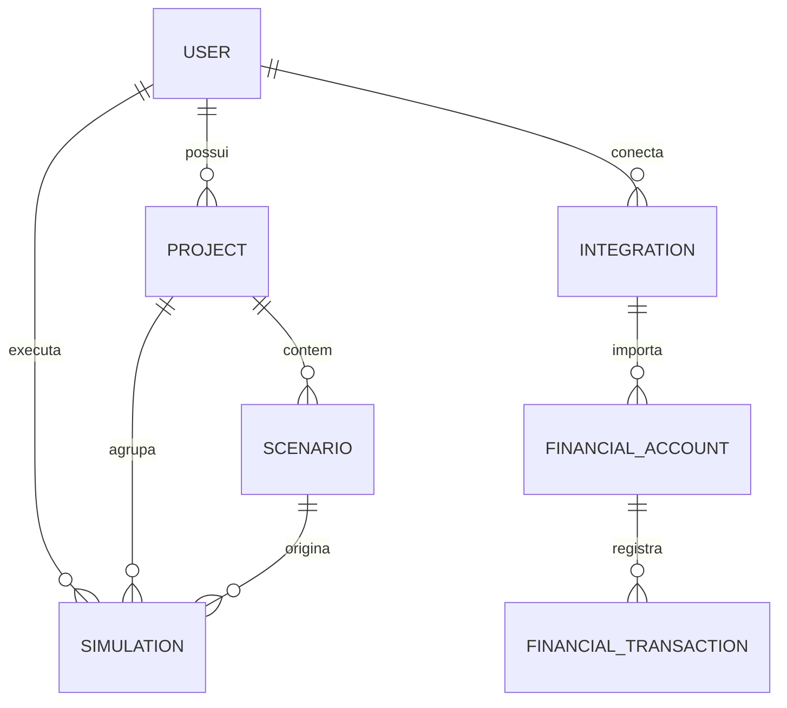

# Modelo conceitual NoSQL — Scenara

## Visão do domínio

O Scenara permite que um usuário crie projetos, defina cenários financeiros e execute simulações. Uma simulação registra um snapshot imutável do cenário e seus resultados, preservando o histórico mesmo após alterações nas premissas.

As referências entre coleções são identificadores (`userId`, `projectId`, `scenarioId`, `integrationId` e `accountId`). Como MongoDB não aplica chaves estrangeiras, a aplicação valida existência, propriedade e acesso a cada referência.



## Coleções

### `users`

Armazena identidade, credencial protegida e papel de acesso do usuário.

| Campo | Tipo | Descrição |
|---|---|---|
| `_id` | `ObjectId`/`String` | Identificador do usuário. |
| `name` | `String` | Nome do usuário. |
| `email` | `String` | E-mail único usado para autenticação. |
| `password` | `String` | Hash da senha; nunca expor pela API. |
| `role` | `String` | Papel de acesso, como `USER` ou `ADMIN`. |
| `createdAt` | `Date` | Momento de criação. |

Índice obrigatório: único em `email`.

### `projects`

Representa uma iniciativa financeira pertencente a um usuário.

| Campo | Tipo | Descrição |
|---|---|---|
| `_id` | `ObjectId`/`String` | Identificador do projeto. |
| `userId` | `ObjectId`/`String` | Referência para `users._id`. |
| `name` | `String` | Nome do projeto. |
| `description` | `String` | Descrição do objetivo analisado. |
| `status` | `String` | Estado, como `ACTIVE` ou `ARCHIVED`. |
| `createdAt` | `Date` | Momento de criação. |

Índice recomendado: `{ userId: 1, createdAt: -1 }`.

### `scenarios`

Um cenário contém uma hipótese financeira de um projeto, como “conservador”, “realista” ou “otimista”. As premissas ficam embutidas porque pertencem ao cenário e são lidas e alteradas como um conjunto.

| Campo | Tipo | Descrição |
|---|---|---|
| `_id` | `ObjectId`/`String` | Identificador do cenário. |
| `projectId` | `ObjectId`/`String` | Referência para `projects._id`. |
| `name` | `String` | Nome da hipótese. |
| `description` | `String` | Descrição opcional da hipótese. |
| `version` | `Integer` | Versão das premissas do cenário. |
| `assumptions` | `Object` | Premissas financeiras usadas no cálculo. |
| `assumptions.initialProductRevenue` | `Decimal128` | Receita mensal inicial de produtos. |
| `assumptions.initialServiceRevenue` | `Decimal128` | Receita mensal inicial de serviços. |
| `assumptions.initialOtherRevenue` | `Decimal128` | Receita mensal inicial de outras fontes. |
| `assumptions.productRevenueGrowth` | `Decimal128` | Crescimento mensal da receita de produtos (`0.08` = 8%; mínimo `-1`). |
| `assumptions.serviceRevenueGrowth` | `Decimal128` | Crescimento mensal da receita de serviços. |
| `assumptions.otherRevenueGrowth` | `Decimal128` | Crescimento mensal das outras receitas. |
| `assumptions.variableCostRate` | `Decimal128` | Custo variável como percentual da receita total. |
| `assumptions.initialFixedCost` | `Decimal128` | Custo fixo mensal inicial. |
| `assumptions.fixedCostGrowthRate` | `Decimal128` | Crescimento mensal do custo fixo. |
| `assumptions.initialInvestment` | `Decimal128` | Investimento inicial (caixa acumulado do mês 0 = `-initialInvestment`). |
| `assumptions.depreciableAssetValue` | `Decimal128` | Valor do ativo depreciável. |
| `assumptions.usefulLifeMonths` | `Integer` | Vida útil do ativo, em meses (positivo). |
| `assumptions.amortizationPerMonth` | `Decimal128` | Amortização mensal. |
| `assumptions.capexRate` | `Decimal128` | CAPEX como percentual da receita total. |
| `assumptions.interestExpense` | `Decimal128` | Despesa mensal de juros, se houver financiamento. |
| `assumptions.effectiveTaxRate` | `Decimal128` | Alíquota efetiva simplificada (`0` a `1`); não representa regime tributário oficial. |
| `assumptions.daysSalesOutstanding` | `Integer` | Prazo médio de recebimento, em dias. |
| `assumptions.daysPayableOutstanding` | `Integer` | Prazo médio de pagamento, em dias. |
| `assumptions.daysInventoryOutstanding` | `Integer` | Prazo médio de estoque, em dias. |
| `assumptions.projectionMonths` | `Integer` | Quantidade de meses da projeção (1 a 600). |
| `createdAt` | `Date` | Momento de criação. |
| `updatedAt` | `Date` | Momento da última alteração. |

Índice recomendado: `{ projectId: 1, createdAt: -1 }`.

### `simulations`

Cada documento é uma execução histórica independente do motor de simulação. O `scenarioSnapshot` guarda a versão exata usada na execução: mudar um cenário de 8% para 12% depois não altera a simulação antiga.

| Campo | Tipo | Descrição |
|---|---|---|
| `_id` | `ObjectId`/`String` | Identificador da simulação. |
| `scenarioId` | `ObjectId`/`String` | Cenário que originou a execução. |
| `projectId` | `ObjectId`/`String` | Projeto da simulação, para consultas diretas. |
| `userId` | `ObjectId`/`String` | Usuário proprietário, para isolamento e consulta. |
| `scenarioSnapshot` | `Object` | Cópia do nome, versão e premissas do cenário. |
| `results` | `Object` | Indicadores finais calculados. |
| `results.totalRevenue` | `Decimal128` | Receita total projetada. |
| `results.totalCosts` | `Decimal128` | Custos operacionais totais (variáveis + fixos). |
| `results.ebitda` | `Decimal128` | EBITDA acumulado no horizonte. |
| `results.ebitdaMargin` | `Decimal128`/`null` | EBITDA / receita total; `null` se não houver receita. |
| `results.ebit` | `Decimal128` | EBIT acumulado. |
| `results.totalIncomeTax` | `Decimal128` | Impostos totais. |
| `results.netIncome` | `Decimal128` | Lucro líquido acumulado. |
| `results.totalCapex` | `Decimal128` | CAPEX total. |
| `results.totalFreeCashFlow` | `Decimal128` | Soma dos fluxos de caixa livres mensais. |
| `results.initialInvestment` | `Decimal128` | Investimento inicial considerado. |
| `results.finalAccumulatedCashFlow` | `Decimal128` | Caixa acumulado ao fim da projeção. |
| `results.paybackMonth` | `Integer`/`null` | Primeiro mês com caixa acumulado `>= 0`; `null` se não ocorreu. |
| `monthlyProjections` | `Array<Object>` | Resultado detalhado para cada mês. |
| `executedAt` | `Date` | Momento da execução. |

Cada item de `monthlyProjections` contém:

| Grupo | Campos |
|---|---|
| Mês | `month` |
| Receita | `productRevenue`, `serviceRevenue`, `otherRevenue`, `totalRevenue` |
| Custos | `variableCost`, `fixedCost`, `operatingCosts` |
| Resultado | `ebitda`, `ebitdaMargin`, `depreciation`, `amortization`, `ebit`, `interestExpense`, `taxableIncome`, `incomeTax`, `netIncome` |
| Capital de giro | `accountsReceivable`, `inventory`, `accountsPayable`, `workingCapital`, `changeInWorkingCapital` |
| Caixa | `capex`, `freeCashFlow`, `accumulatedCashFlow` |

#### Motor de cálculo

A projeção é mensal e sequencial: cada mês usa apenas valores do próprio mês ou do mês anterior. No mês 1, os valores iniciais já recebem o crescimento.

```
Receita[n]            = Receita[n-1] × (1 + crescimento)        (por fonte)
CustoVariável[n]      = ReceitaTotal[n] × variableCostRate
CustoFixo[n]          = CustoFixo[n-1] × (1 + fixedCostGrowthRate)
EBITDA[n]             = ReceitaTotal[n] − CustosOperacionais[n]
Depreciação[n]        = depreciableAssetValue / usefulLifeMonths
EBIT[n]               = EBITDA[n] − Depreciação[n] − Amortização[n]
LucroTributável[n]    = EBIT[n] − interestExpense
Imposto[n]            = MAX(0, LucroTributável[n]) × effectiveTaxRate
LucroLíquido[n]       = LucroTributável[n] − Imposto[n]
ContasAReceber[n]     = ReceitaTotal[n] × (daysSalesOutstanding / 30)
ContasAPagar[n]       = CustosOperacionais[n] × (daysPayableOutstanding / 30)
Estoque[n]            = CustoVariável[n] × (daysInventoryOutstanding / 30)
CapitalDeGiro[n]      = ContasAReceber[n] + Estoque[n] − ContasAPagar[n]
ΔCapitalDeGiro[n]     = CapitalDeGiro[n] − CapitalDeGiro[n-1]   (CapitalDeGiro[0] = 0)
CAPEX[n]              = ReceitaTotal[n] × capexRate
FluxoCaixaLivre[n]    = EBITDA[n] − Imposto[n] − ΔCapitalDeGiro[n] − CAPEX[n]
CaixaAcumulado[0]     = −initialInvestment
CaixaAcumulado[n]     = CaixaAcumulado[n-1] + FluxoCaixaLivre[n]
```

Os juros ficam fora do fluxo de caixa livre operacional, pois pertencem ao financiamento. A depreciação reduz o lucro contábil, mas não é saída de caixa.

Índices recomendados: `{ scenarioId: 1, executedAt: -1 }`, `{ projectId: 1, executedAt: -1 }` e `{ userId: 1, executedAt: -1 }`.

### `integrations`

Guarda uma conexão do usuário com um provedor financeiro, como Pluggy.

| Campo | Tipo | Descrição |
|---|---|---|
| `_id` | `ObjectId`/`String` | Identificador da integração. |
| `userId` | `ObjectId`/`String` | Referência para `users._id`. |
| `provider` | `String` | Provedor, como `PLUGGY`. |
| `status` | `String` | Estado da conexão, como `CONNECTED`. |
| `externalItemId` | `String` | Identificador no provedor externo. |
| `lastSyncAt` | `Date` | Data da última sincronização. |

Índice recomendado: `{ userId: 1, provider: 1 }`.

### `financial_accounts`

Armazena contas importadas por uma integração financeira.

| Campo | Tipo | Descrição |
|---|---|---|
| `_id` | `ObjectId`/`String` | Identificador da conta. |
| `userId` | `ObjectId`/`String` | Proprietário da conta. |
| `integrationId` | `ObjectId`/`String` | Integração que forneceu a conta. |
| `name` | `String` | Nome da conta. |
| `type` | `String` | Tipo, como `CHECKING`. |
| `currency` | `String` | Moeda ISO 4217, como `BRL`. |
| `balance` | `Decimal128` | Saldo informado pelo provedor. |

Índice recomendado: `{ userId: 1, integrationId: 1 }`.

### `financial_transactions`

Registra movimentações financeiras importadas das contas.

| Campo | Tipo | Descrição |
|---|---|---|
| `_id` | `ObjectId`/`String` | Identificador da transação. |
| `userId` | `ObjectId`/`String` | Proprietário da transação. |
| `accountId` | `ObjectId`/`String` | Conta associada. |
| `description` | `String` | Descrição recebida do provedor. |
| `amount` | `Decimal128` | Valor da movimentação. |
| `type` | `String` | Tipo, como `EXPENSE` ou `INCOME`. |
| `category` | `String` | Categoria, como `SUPPLIERS`. |
| `transactionDate` | `Date` | Data da movimentação. |

Índice recomendado: `{ accountId: 1, transactionDate: -1 }`.

## Decisões de modelagem

- **Referências entre agregados:** usuários, projetos, cenários, integrações e contas têm ciclo de vida próprio e ficam em coleções separadas.
- **Premissas em `scenarios`:** não é necessária uma coleção para cada variável financeira; elas formam uma única hipótese.
- **Snapshot em `simulations`:** resultados históricos permanecem reproduzíveis após uma alteração no cenário.
- **Dados financeiros:** usar `Decimal128` no MongoDB e `BigDecimal` no Java; nunca `double`.
- **Duplicação intencional:** `projectId` e `userId` em `simulations` simplificam listagens e isolamento por usuário.

## Regras de integridade

1. O projeto deve pertencer ao `userId` autenticado.
2. Um cenário só pode ser criado ou consultado em um projeto do usuário.
3. Uma simulação só pode usar cenário do mesmo `projectId`.
4. `projectionMonths` deve ser inteiro positivo; as taxas devem respeitar limites de negócio definidos.
5. A exclusão de projeto precisa de uma política explícita: bloquear quando houver dependências ou excluir cenários e simulações em cascata.
